# Connectors
Mục tiêu của lab là xây dựng một hệ thống Threat Intelligence để thu thập IOC và thông tin về mối đe dọa từ nhiều nguồn, tập trung dữ liệu về OpenCTI, sau đó đưa dữ liệu sang Splunk để phục vụ việc hunting và detection.
Kiến trúc tổng thể:
```
Kiến trúc tổng thể:

MITRE ATT&CK ─────┐
                  │
ThreatFox ────────┤
                  │
MISP ─────────────┤
                  ▼
               OpenCTI
                  │
                  ▼
            OpenCTI Stream
                  │
                  ▼
              Splunk SIEM
                  │
                  ▼
          IOC Correlation
                  │
                  ▼
              Alert/Incident
```


## MITRE ATT&CK
MITRE ATT&CK được sử dụng để bổ sung phần thông tin về hành vi của attacker cho hệ thống.

Trong giao diện OpenCTI, MITRE ATT&CK xuất hiện dưới Integration Manager.

Tuy nhiên integration này yêu cầu: **Enterprise Edition / License**
=> Giải pháp: thay vì sử dụng integration đó, mình triển khai MITRE Connector riêng bằng Docker.
Kiến trúc:

```
MITRE ATT&CK
      ↓
 MITRE Connector
      ↓
    RabbitMQ
      ↓
 OpenCTI Worker
      ↓
    OpenCTI
```

#### Tạo thư mục MITRE Connector
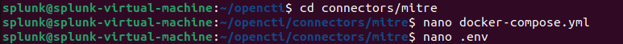
Connector được chạy bằng Docker Compose riêng.
Điểm quan trọng là connector phải kết nối vào network OpenCTI:
 `xtm_default`

Cấu hình trong MITRE Connector
`cat docker-compose.yml `
```
services:
  connector-mitre:
    image: opencti/connector-mitre:latest

    environment:
      - OPENCTI_URL=http://opencti:8080
      - OPENCTI_TOKEN=${OPENCTI_TOKEN}

      - CONNECTOR_ID=${CONNECTOR_ID}
      - CONNECTOR_TYPE=EXTERNAL_IMPORT
      - CONNECTOR_NAME=MITRE ATT&CK

      - CONNECTOR_SCOPE=marking-definition,identity,attack-pattern,course-of-action,intrusion-set,campaign,malware,tool,report,x-mitre-collection,x-mitre-data-component,x-mitre-data-source,x-mitre-matrix,x-mitre-tactic

      - CONNECTOR_CONFIDENCE_LEVEL=75
      - CONNECTOR_UPDATE_EXISTING_DATA=true
      - CONNECTOR_LOG_LEVEL=info

      - MITRE_ENTERPRISE_FILE_URL=https://raw.githubusercontent.com/mitre/cti/master/enterprise-attack/enterprise-attack.json
      - MITRE_PRE_ATTACK_FILE_URL=https://raw.githubusercontent.com/mitre/cti/master/pre-attack/pre-attack.json
      - MITRE_MOBILE_ATTACK_FILE_URL=https://raw.githubusercontent.com/mitre/cti/master/mobile-attack/mobile-attack.json
      - MITRE_ICS_ATTACK_FILE_URL=https://raw.githubusercontent.com/mitre/cti/master/ics-attack/ics-attack.json

      - MITRE_INTERVAL=7

    restart: unless-stopped

    networks:
      - opencti

networks:
  opencti:
    external: true
    name: xtm_default
```

`.env`
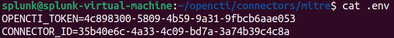

Điểm cần chú ý là connector phải nằm cùng Docker network với OpenCTI: `xtm_default`
Khởi động MITRE CONNECTOR
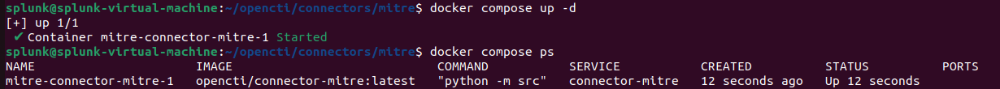


## ThreatFox Connector
ThreatFox được sử dụng làm thêm một nguồn Threat Intelligence cho OpenCTI.
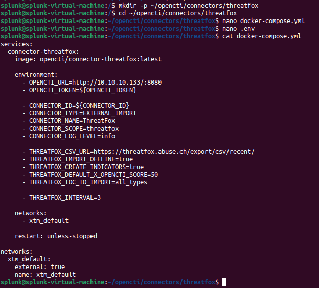

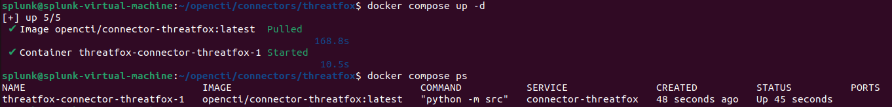


## MISP
MISP được triển khai để quản lý Event và IOC, sau đó sử dụng MISP Connector để đưa dữ liệu sang OpenCTI.

### Triển khai MISP
Cấu hình file .env
Cấu hình port
User và passwd như mặc định
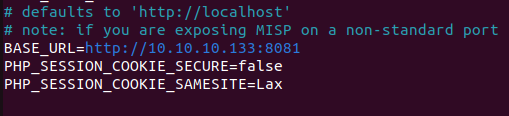

Sau khi cấu hình .evn, khởi động:
```
-> docker compose pull
-> docker compose up -d
```
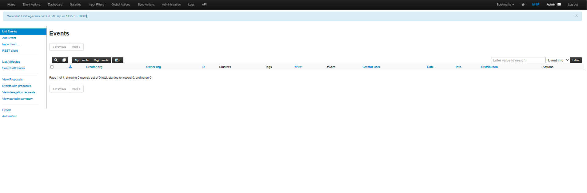

### Tạo tài khoản riêng cho MISP Connector
username: misp-opencti@lab.local => Tài khoản này được dùng riêng cho việc kết nối API giữa MISP và OpenCTI.
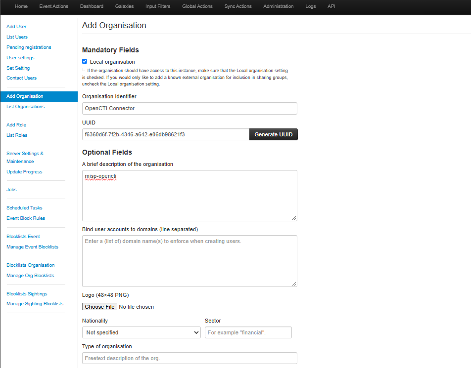

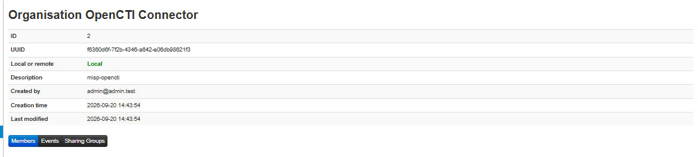


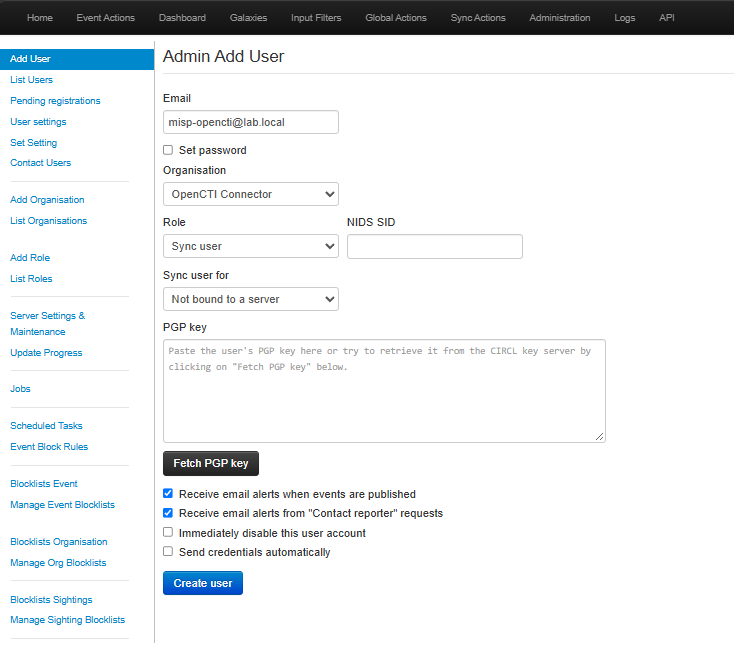

Tạo user misp-opencti@lab.local
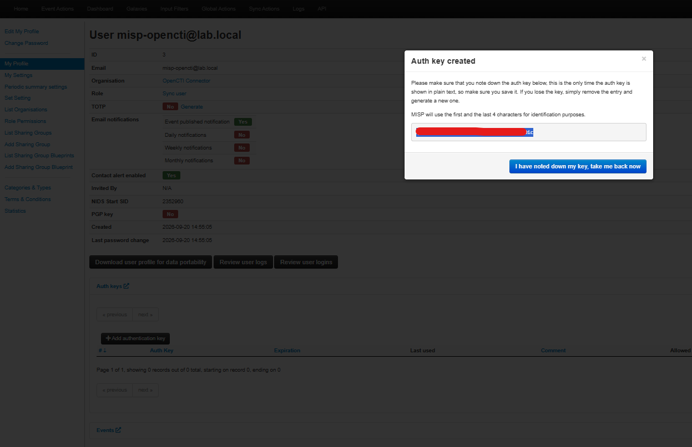

Sau khi tạo API key, kiểm tra kết nối: 
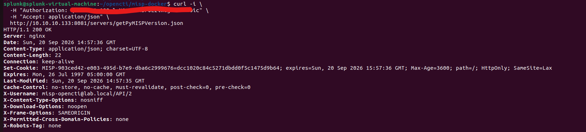
Nếu nhận được HTTP 200 OK thì có thể xác nhận => MISP đang hoạt động

### Cấu hình MISP Connector

Cấu hình file .env
```
splunk@splunk-virtual-machine:~/opencti/connectors/misp$ cat .env


OPENCTI_URL=http://10.10.10.133:8080
OPENCTI_TOKEN=flg*****Bs3Z-C

CONNECTOR_ID=cbb***b090
CONNECTOR_TYPE=EXTERNAL_IMPORT
CONNECTOR_NAME=MISP
CONNECTOR_SCOPE=misp
CONNECTOR_LOG_LEVEL=info
CONNECTOR_DURATION_PERIOD=PT5M  #Connector sẽ chạy theo chu kỳ 5 phút.

MISP_URL=http://10.10.10.133:8081
MISP_KEY=qOt9AWrOg08QvlcNOPcBDnBF0EziwagDMtxLN0ic
MISP_SSL_VERIFY=False

MISP_CREATE_REPORTS=True
MISP_CREATE_INDICATORS=True
MISP_CREATE_OBSERVABLES=True #Cho phép tạo Indicator trong OpenCTI từ dữ liệu MISP.
MISP_CREATE_OBJECT_OBSERVABLES=True
MISP_CREATE_TAGS_AS_LABELS=True

MISP_REPORT_TYPE=misp-event
MISP_IMPORT_FROM_DATE=2026-09-20
MISP_IMPORT_DISTRIBUTION_LEVELS=0,1,2,3
MISP_IMPORT_THREAT_LEVELS=1,2,3,4
```


```
splunk@splunk-virtual-machine:~/opencti/connectors/misp$ cat docker-compose.yml 
services:
  connector-misp:
    image: opencti/connector-misp:latest
    container_name: opencti-connector-misp

    environment:
      OPENCTI_URL: ${OPENCTI_URL}
      OPENCTI_TOKEN: ${OPENCTI_TOKEN}

      CONNECTOR_ID: ${CONNECTOR_ID}
      CONNECTOR_TYPE: ${CONNECTOR_TYPE}
      CONNECTOR_NAME: ${CONNECTOR_NAME}
      CONNECTOR_SCOPE: ${CONNECTOR_SCOPE}
      CONNECTOR_LOG_LEVEL: ${CONNECTOR_LOG_LEVEL}
      CONNECTOR_DURATION_PERIOD: ${CONNECTOR_DURATION_PERIOD}

      MISP_URL: ${MISP_URL}
      MISP_KEY: ${MISP_KEY}
      MISP_SSL_VERIFY: ${MISP_SSL_VERIFY}

      MISP_CREATE_REPORTS: ${MISP_CREATE_REPORTS}
      MISP_CREATE_INDICATORS: ${MISP_CREATE_INDICATORS}
      MISP_CREATE_OBSERVABLES: ${MISP_CREATE_OBSERVABLES}
      MISP_CREATE_OBJECT_OBSERVABLES: ${MISP_CREATE_OBJECT_OBSERVABLES}
      MISP_CREATE_TAGS_AS_LABELS: ${MISP_CREATE_TAGS_AS_LABELS}

      MISP_REPORT_TYPE: ${MISP_REPORT_TYPE}
      MISP_IMPORT_FROM_DATE: ${MISP_IMPORT_FROM_DATE}
      MISP_IMPORT_DISTRIBUTION_LEVELS: ${MISP_IMPORT_DISTRIBUTION_LEVELS}
      MISP_IMPORT_THREAT_LEVELS: ${MISP_IMPORT_THREAT_LEVELS}

    restart: unless-stopped

    networks:
      - xtm
      - misp

networks:
  xtm:
    external: true
    name: xtm_default

  misp:
    external: true
    name: misp-docker_default

```

> OpenCTI và MISP đang chạy trên hai Docker network khác nhau:
> OpenCTI: xtm_default
> MISP: misp-docker_default
> => MISP Connector cần giao tiếp với cả hai nên phải tham gia cả hai network.

Chạy MISP Connector 
`docker compose up -d`

Kiểm tra dữ liệu trên OpenCTI
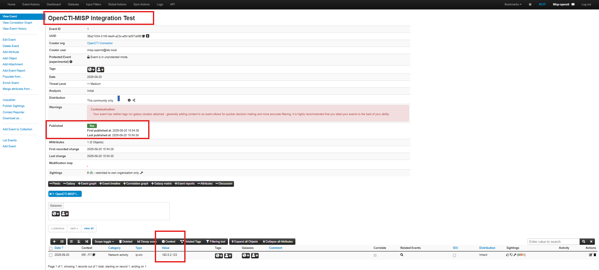

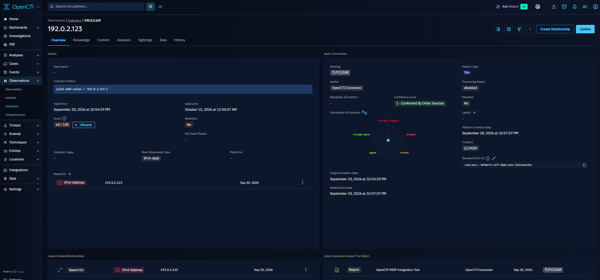

## Tích hợp OpenCTI vào Splunk
Installing from file through the UI
1. Download latest version of the Splunk App: `TA-opencti-for-splunk-enterprise-1.1.0.tar.gz`
2. Log in to the Splunk Web UI and navigate to "Apps" and click on "Manage Apps"
3. Click "Install app from file"
4. Choose file and select the `TA-opencti-for-splunk-enterprise-1.1.0.tar.gz` file
5. Click on Upload The app is installed

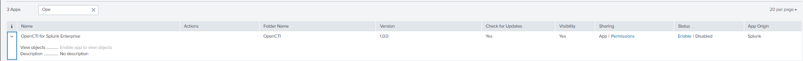

Tạo một Live Stream trong OpenCTI:
Name:
Splunk SIEM Stream
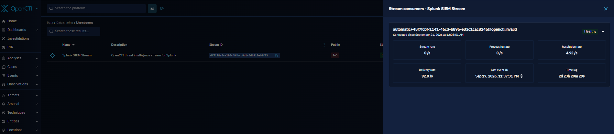


Sau đó sử dụng Stream ID của stream này để cấu hình Input trên Splunk.
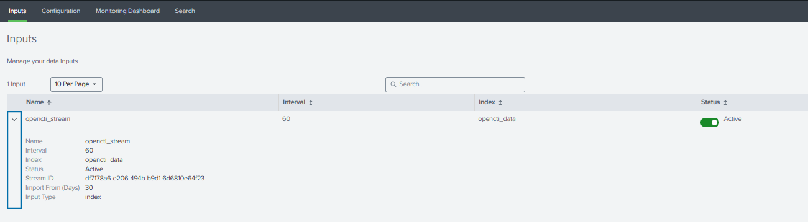

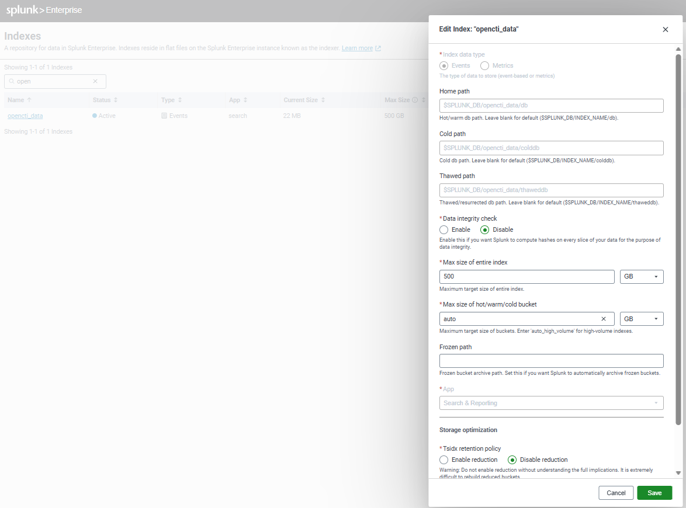

Kết quả:
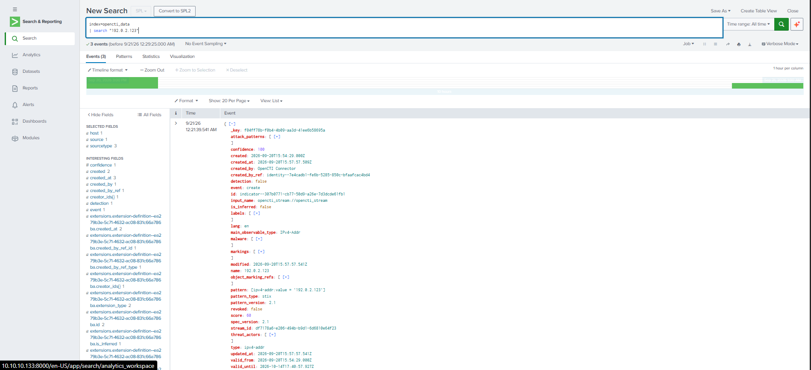

## Dection Use Case

```
index=* EventCode=22
| eval query=lower(rtrim(QueryName,"."))
| join type=inner query [
    search index=opencti_data sourcetype="opencti:indicator" type="domain-name"
    | eval query=lower(rtrim(value,"."))
    | stats
        max(confidence) as ioc_confidence
        max(score) as ioc_score
        values(name) as ioc_name
        values(value) as ioc_value
        values(created_by) as ioc_source
        values(description) as ioc_description
        by query
]
| eval detection_name="OpenCTI IOC - DNS Query"
| eval severity=case(
    ioc_confidence>=90,"high",
    ioc_confidence>=70,"medium",
    true(),"low"
)
| table _time host User Image ProcessId ProcessGuid QueryName QueryResults ioc_name ioc_source ioc_confidence ioc_score detection_name severity
```
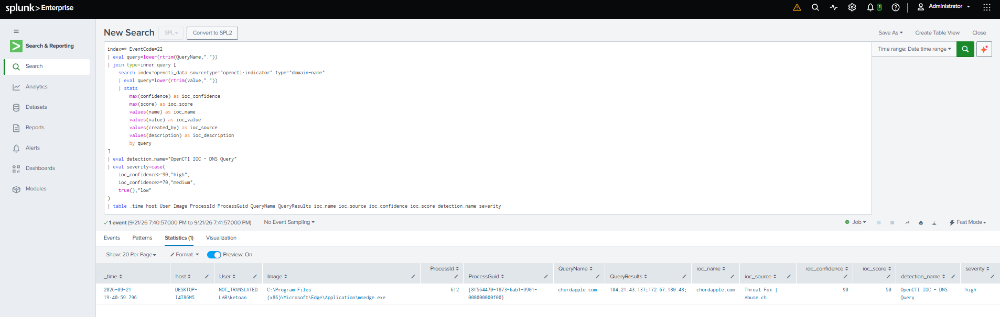

```
index=* EventCode=3
| eval dest_ip=lower(DestinationIp)
| join type=inner dest_ip [
    search index=opencti_data sourcetype="opencti:indicator" type="ipv4-addr"
    | eval dest_ip=lower(value)
    | stats
        max(confidence) as ioc_confidence
        max(score) as ioc_score
        values(name) as ioc_name
        values(value) as ioc_value
        values(created_by) as ioc_source
        values(description) as ioc_description
        by dest_ip
]
| eval detection_name="OpenCTI IOC - Malicious IP Connection"
| eval severity=case(
    ioc_confidence>=90,"high",
    ioc_confidence>=70,"medium",
    true(),"low"
)
| table _time host User Image ProcessId ProcessGuid SourceIp SourcePort DestinationIp DestinationPort Protocol ioc_name ioc_source ioc_confidence ioc_score detection_name severity
```


