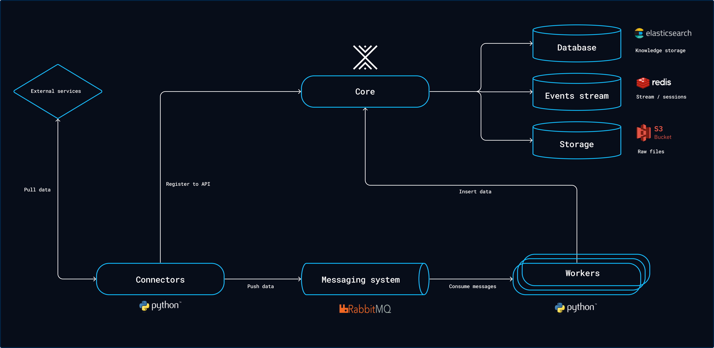

# Overview
Trước khi bắt đầu cài đặt, hãy cùng tìm hiểu cách thức hoạt động của OpenCTI, các thành phần phụ thuộc cần thiết và những yêu cầu tối thiểu để triển khai hệ thống trong môi trường thực tế (production).

## Kiến trúc

OpenCTI thực chất không phải là 1 container duy nhất. Nó là một nền tảng phụ thuộc vào nhiều service bên ngoài
* Elasticsearch/OpenSearch: lưu trữ và tìm kiếm dữ liệu CTI.
* Redis: hỗ trợ caching và xử lý trạng thái/phối hợp.
* RabbitMQ: message broker, trung gian truyền các tác vụ.
* S3/Silo/MinIO: lưu trữ object/file.
* OpenCTI Platform: giao diện web + GraphQL API.
* Workers: xử lý các tác vụ ghi dữ liệu bất đồng bộ.
* Connectors: lấy/enrich/export dữ liệu từ các nguồn bên ngoài.

## OpenCTI Platform [THÀNH PHẦN CHUNG TÂM CỦA OPENCTI]
- Cung cấp WEB UI, GraphQL
- Connector và Worker sử dụng GraphQL để tương tác với OpenCTI

## Worker [một process Python đọc message từ RabbitMQ và thực hiện write quety bất đông bộ, có thể chạy nhiều worker để tăng cả năng đồng bộ]

              RabbitMQ
                  │
          ┌───────┼───────┐
          ▼       ▼       ▼
       Worker1 Worker2 Worker3
          │       │       │
          └───────┼───────┘
                  ▼
                 Core

## Core [trung tâm của OpenCTI Platform, cung cấp logic nghiệp vụ và API của OpenCTI]

Connectors là các process, thường viết bằng Python, có nhiệm vụ kết nối tới nguồn dữ liệu bên ngoài, lấy dữ liệu, chuyển đổi thành STIX 2.1 và gửi dữ liệu vào OpenCTI thông qua API/ingestion queue.
```
Connectors
     │
     │ Register to API (cung cấp GraphQL API)
     ▼
    Core
```
OpenCTI Workers là các process Python chạy độc lập, consume message từ RabbitMQ và thực hiện các thao tác ghi dữ liệu bất đồng bộ vào OpenCTI

```
Workers
    │
    │ Insert data
    ▼
   Core
```
## Ba kho dữ liệu bên phải
Core kết nối dữ liệu với 3 thành phần chính:
```
Core
 ├──→ Database ()
 ├──→ Events stream
 └──→ Storage
```

1. Phía trên **Elasticsearch — Database**
    Elasticsearch là backend dữ liệu quan trọng cho việc lưu trữ/index và tìm kiếm dữ liệu
    Nơi OpenCTI lưu knowledge graph/searchable knowledge.
        Ví dụ các object: Attack Pattern, Malware, Campaign,..., MITRE (T1059, PowerShell, APT29, Mimikatz) được đưa vào knowledge base của OpenCTI.
2. Ở giữa **Redis — Events Stream**
    Đảm nhiệm lquan đến Event Stream, Sessions => đặc biệt quan trọng để đưa dữ liệu sang Splunk
3. Phía dưới **S3 / MinIO — Storage**
    Dùng để lưu các file/object lớn hoặc dữ liệu dạng file.
    

> Connector lấy và chuẩn hóa dữ liệu → RabbitMQ xếp hàng → Worker consume và ghi bất đồng bộ → OpenCTI Core quản lý platform → Elasticsearch phục vụ index/search → Redis phục vụ event stream → S3/MinIO lưu object/file.---
title: Overview
tags: [onboarding]

---