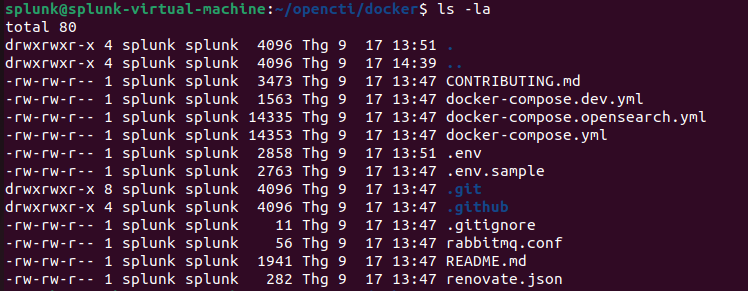
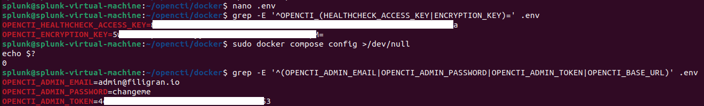
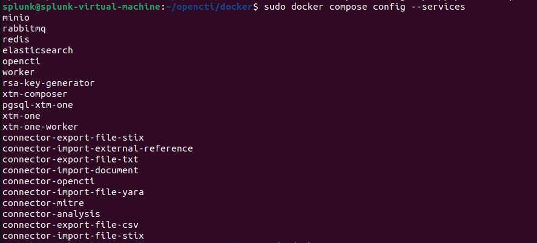
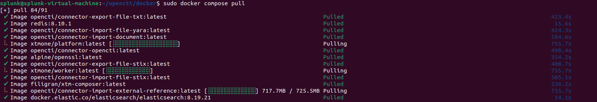
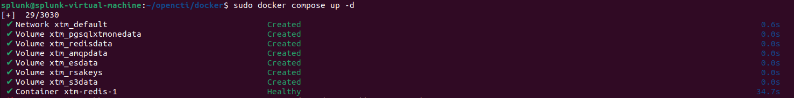
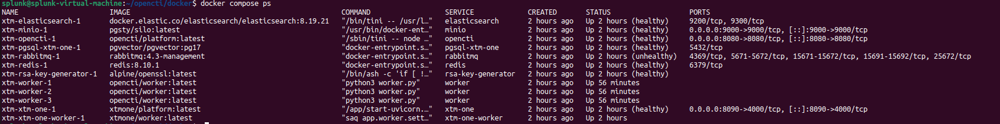
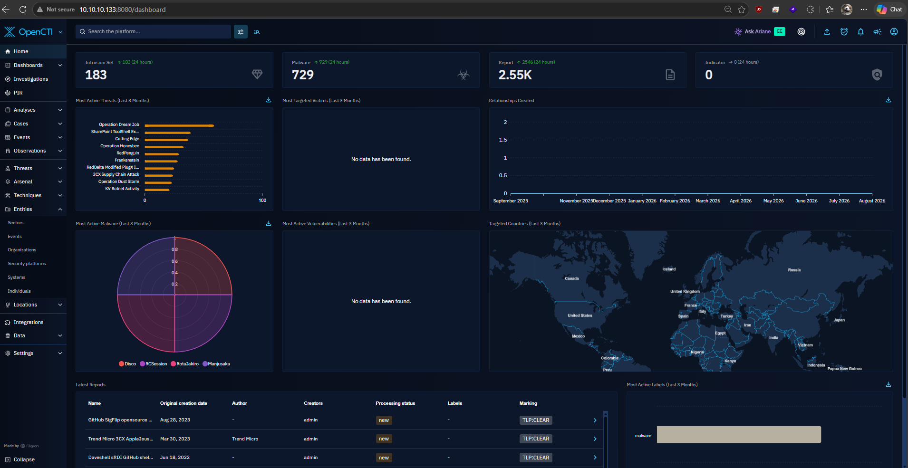

# Xây dựng Threat Intelligence Pipeline với OpenCTI → Splunk SIEM
Triển khai OpenCTI trên Ubuntu bằng Docker, tích hợp MITRE ATT&CK, sau đó xây dựng pipeline đưa IOC từ OpenCTI vào Splunk SIEM để phục vụ Threat Hunting và Detection En


## Mục tiêu của Lab
                    Threat Intelligence
                           │
             ┌─────────────┴─────────────┐
             │                           │
        MITRE ATT&CK                 IOC Feeds
             │                           │
             └─────────────┬─────────────┘
                           ▼
                    ┌─────────────┐
                    │   OpenCTI   │
                    │     TIP     │
                    └──────┬──────┘
                           │
                       IOC Export
                           │
                           ▼
                    ┌─────────────┐
                    │   Splunk    │
                    │     SIEM    │
                    └──────┬──────┘
                           │
                 ┌─────────┼─────────┐
                 ▼         ▼         ▼
              IOC Match  Hunting   Alert

Trong đó:
* OpenCTI: Threat Intelligence Platform.
* MITRE ATT&CK: cung cấp knowledge về tactic, technique, software, group...
* IOC feeds: cung cấp IP, domain, URL, hash...
* Splunk: sử dụng IOC từ OpenCTI để correlation với security logs.
* SOC Analyst: sử dụng kết quả để hunting và investigation.
## Môi trường Lab
Server sử dụng:

```
OS          : Ubuntu 22.04.5 LTS
Architecture: amd64
Hostname    : splunk-virtual-machine
User        : splunk
IP          : 10.10.10.133
RAM         : ~10 GB
```

Splunk đang chạy trên cùng server:

```
Splunk Web : TCP/8000
Splunk UF  : TCP/9997
```

OpenCTI:

`OpenCTI : TCP/8080`

## Cấu hình ElasticSearch / OpenSearch
Cấu hình tối ưu OpenCTI (ElasticSearch, RabbitMQ, Linux System)

**Hệ thống Linux Host (Bắt buộc trước khi chạy Docker)**
Tránh lỗi Out of Memory làm dừng/crash ElasticSearch.
`sudo sysctl -w vm.max_map_count=1048575`
Lưu vĩnh viễn (Sửa /etc/sysctl.conf):`vm.max_map_count=1048575`

**Cấu hình ElasticSearch / OpenSearch (docker-compose.yml)**
`thread_pool.search.queue_size=5000`
=> Tăng hàng đợi tìm kiếm lên 5.000 để xử lý tốt nhiều truy vấn cùng lúc, tránh bị nghẽn (EsRejectedExecutionException).

**Cấu hình RabbitMQ (rabbitmq.conf)**
`max_message_size = 536870912` (512 MB) => Tăng kích thước gói tin tối đa để xử lý các nguồn dữ liệu tình báo (Feeds/IOCs) dung lượng lớn.
`consumer_timeout = 86400000` (24 giờ): => Gia hạn thời gian chờ xử lý tin nhắn, tránh đứt đoạn kết nối khi import hoặc enrich dữ liệu nặng.

## Cài đặt Docker

```
# Gỡ bỏ các phiên bản Docker cũ => tránh xung đột
sudo apt remove $(dpkg --get-selections docker.io docker-compose docker-compose-v2 docker-doc podman-docker containerd runc | cut -f1)
# Tải và thêm khóa GPG chính thức của Docker => đảm bảo xác thực được các gói phần mềm tải từ Docker là an toàn
sudo apt update
sudo apt install ca-certificates curl
sudo install -m 0755 -d /etc/apt/keyrings
sudo curl -fsSL https://download.docker.com/linux/ubuntu/gpg -o /etc/apt/keyrings/docker.asc
sudo chmod a+r /etc/apt/keyrings/docker.asc

# Thêm Repository của Docker vào APT => khai báo cho trình quản lý gói APT biết các phiên bản docker mới nhất
sudo tee /etc/apt/sources.list.d/docker.sources <<EOF
Types: deb
URIs: https://download.docker.com/linux/ubuntu
Suites: $(. /etc/os-release && echo "${UBUNTU_CODENAME:-$VERSION_CODENAME}")
Components: stable
Signed-By: /etc/apt/keyrings/docker.asc
EOF
# Cài Docker bản mới nhất
sudo apt install docker-ce docker-ce-cli containerd.io docker-buildx-plugin docker-compose-plugin
sudo apt update
```

## Download OpenCTI

```
git clone https://github.com/OpenCTI-Platform/opencti.git
cd ~/opencti/docker
```


## Cấu hình .env
OpenCTI sử dụng .env để cấu hình.
```
MINIO_ROOT_USER=opencti
MINIO_ROOT_PASSWORD=<SECRET>

RABBITMQ_DEFAULT_USER=opencti
RABBITMQ_DEFAULT_PASS=<SECRET>

ELASTIC_MEMORY_SIZE=4G

OPENCTI_HOST=localhost
OPENCTI_PORT=8080
OPENCTI_EXTERNAL_SCHEME=http

OPENCTI_ADMIN_EMAIL=admin@filigran.io
OPENCTI_ADMIN_PASSWORD=<SECRET>

OPENCTI_ADMIN_TOKEN=<UUID>

OPENCTI_HEALTHCHECK_ACCESS_KEY=<UUID>

OPENCTI_ENCRYPTION_KEY=<BASE64_KEY>
```



Tạo UUID: `uuidgen`
Tạo encryption key:` openssl rand -base64 32`

List các service có trong file docker-compose.yml: 
`sudo docker compose config --services`


Download/Update cho các Docker Imange phiên bản mới cho các dịch vụ: `sudo docker compose pull`


## Khởi động OpenCTI
Sau khi cấu hình: `sudo docker compose up -d`


Kiểm tra: `sudo docker compose ps`

Các thành phần chính:
* OpenCTI
* Elasticsearch
* PostgreSQL
* RabbitMQ
* Redis
* MinIO
* Workers
* Connectors



## Khởi động OpenCTI
=> Truy cập: http://10.10.10.133:8080/dashboard




